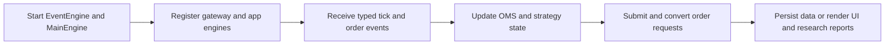
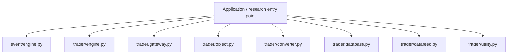
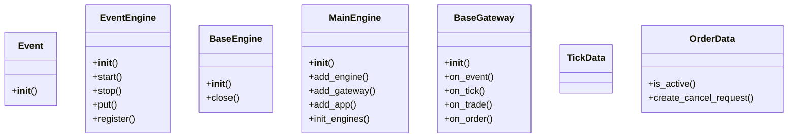
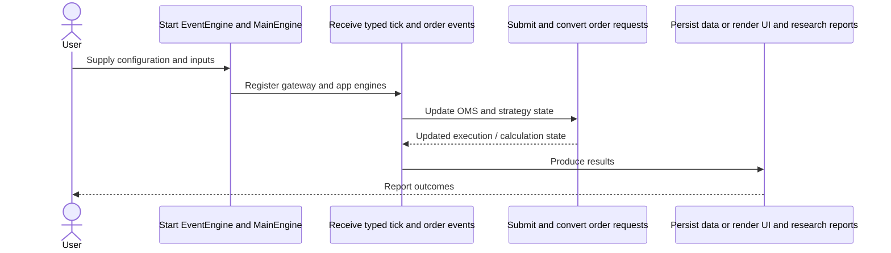
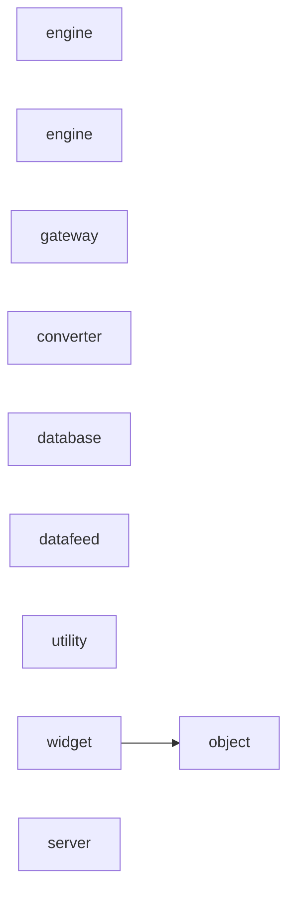
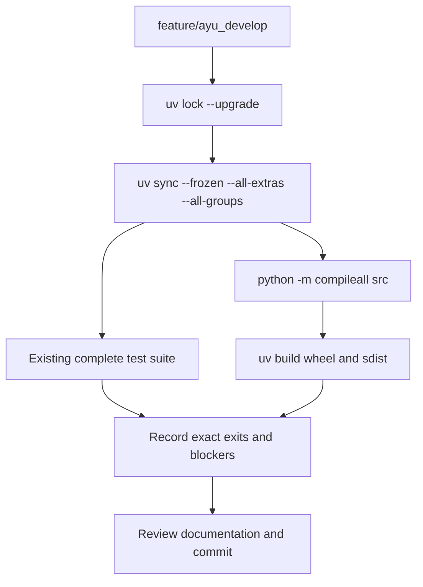

# vnpy: development, architecture and operations

Updated 2026-10-12 on `feature/ayu_develop`; source snapshot `c3f371e628a7`. This guide follows the source in this checkout and separates available interfaces from verification evidence.

## Purpose and feature boundaries

An event-driven quantitative trading application framework with gateways, engine services, typed market/order objects, Qt UI, charting, RPC and alpha research.

EventEngine queues callbacks, while MainEngine owns gateway/app/service registration. BaseGateway adapts broker transport; typed dataclasses carry market and execution state. OMS and offset conversion separate account/position semantics from UI rendering. Alpha modules add factor datasets, models and portfolio backtesting. Qt and optional ML/native dependencies constrain interpreter support.

## Main workflow

The following is the repository-specific logical workflow. Runtime execution details remain in the linked source and the validation record.

1. Start EventEngine and MainEngine.
2. Register gateway and app engines.
3. Receive typed tick and order events.
4. Update OMS and strategy state.
5. Submit and convert order requests.
6. Persist data or render UI and research reports.

## Components and ownership

The entry point composes the source modules below; arrows indicate review/navigation boundaries rather than a claim that every module is called in every run.

| Source | Declared classes / functions | Implementation role |
|---|---|---|
| [src/vnpy/event/engine.py](../src/vnpy/event/engine.py) | Event, EventEngine | Event-driven framework of VeighNa framework. |
| [src/vnpy/trader/engine.py](../src/vnpy/trader/engine.py) | BaseEngine, MainEngine, LogEngine, OmsEngine, EmailEngine, WechatEngine | Engines for gateway routing, order management, logging, email, and WeChat. |
| [src/vnpy/trader/gateway.py](../src/vnpy/trader/gateway.py) | BaseGateway | Abstract gateway for connections to trading systems. |
| [src/vnpy/trader/object.py](../src/vnpy/trader/object.py) | BaseData, TickData, BarData, OrderData, TradeData, PositionData | Basic data structure used for general trading function in the trading platform. |
| [src/vnpy/trader/converter.py](../src/vnpy/trader/converter.py) | PositionHolding, OffsetConverter | Position holdings and offset conversion for close, lock, and net modes. |
| [src/vnpy/trader/database.py](../src/vnpy/trader/database.py) | BarOverview, TickOverview, BaseDatabase; convert_tz, get_database | Abstract database and loader for bar and tick storage. |
| [src/vnpy/trader/datafeed.py](../src/vnpy/trader/datafeed.py) | BaseDatafeed; get_datafeed | Abstract datafeed and loader for history data services. |
| [src/vnpy/trader/utility.py](../src/vnpy/trader/utility.py) | BarGenerator, ArrayManager; extract_vt_symbol, generate_vt_symbol, _get_trader_dir, get_file_path | General utility functions. |
| [src/vnpy/chart/widget.py](../src/vnpy/chart/widget.py) | ChartWidget, ChartCursor | Chart widget and crosshair cursor. |
| [src/vnpy/rpc/server.py](../src/vnpy/rpc/server.py) | RpcServer | ZeroMQ RPC server. |
| [src/vnpy/rpc/client.py](../src/vnpy/rpc/client.py) | RemoteException, RpcClient | See the public declarations and implementation linked here. |
| [src/vnpy/alpha/lab.py](../src/vnpy/alpha/lab.py) | AlphaLab | Research workspace that stores bars, index components, contracts, datasets, models, and signals. |
| [src/vnpy/alpha/dataset/factor_performance.py](../src/vnpy/alpha/dataset/factor_performance.py) | FactorMetrics; prepare_factor_data, compute_factor_metrics, create_full_tear_sheet, _custom_business_day | See the public declarations and implementation linked here. |
| [src/vnpy/alpha/strategy/backtesting.py](../src/vnpy/alpha/strategy/backtesting.py) | BacktestingEngine, ContractDailyResult, PortfolioDailyResult | Backtesting engine for alpha portfolio strategies. |

## Class design

Methods and inheritance edges are taken from the selected declarations in the actual source. A missing edge means composition or an external base is not asserted here.

## End-to-end interaction

This sequence presents the responsibilities of the main workflow, including the state/result boundary. The linked classes and functions provide the exact method-level contract.

## Source dependency direction

These edges are actual explicit imports between the selected source modules. Dynamic imports, re-exports and third-party internals are omitted.

## Design details and extension points

### `Event`

Source: [src/vnpy/event/engine.py](../src/vnpy/event/engine.py).

Event object consists of a type string which is used
by event engine for distributing event, and a data
object which contains the real data.

### `EventEngine`

Source: [src/vnpy/event/engine.py](../src/vnpy/event/engine.py).

Event engine distributes event object based on its type
to those handlers registered.

- `start`: Start event engine to process events and generate timer events.
- `stop`: Stop event engine.
- `put`: Put an event object into event queue.
- `register`: Register a new handler function for a specific event type. Every function can only be registered once for each event type.
- `unregister`: Unregister an existing handler function from event engine.

### `BaseEngine`

Source: [src/vnpy/trader/engine.py](../src/vnpy/trader/engine.py).

Abstract class for implementing a function engine.

- `close`: Do nothing when the engine is closed.

### `MainEngine`

Source: [src/vnpy/trader/engine.py](../src/vnpy/trader/engine.py).

Acts as the core of the trading platform.

- `add_engine`: Add function engine.
- `add_gateway`: Add gateway.
- `add_app`: Add app.
- `init_engines`: Init all engines.
- `write_log`: Put log event with specific message.

### `BaseGateway`

Source: [src/vnpy/trader/gateway.py](../src/vnpy/trader/gateway.py).

Abstract gateway class for creating gateways connection
to different trading systems.

- `on_event`: General event push.
- `on_tick`: Tick event push. Tick event of a specific vt_symbol is also pushed.
- `on_trade`: Trade event push. Trade event of a specific vt_symbol is also pushed.
- `on_order`: Order event push. Order event of a specific vt_orderid is also pushed.
- `on_position`: Position event push. Position event of a specific vt_symbol is also pushed.

### `TickData`

Source: [src/vnpy/trader/object.py](../src/vnpy/trader/object.py).

Tick data contains information about:
    * last trade in market
    * orderbook snapshot
    * intraday market statistics.

### `OrderData`

Source: [src/vnpy/trader/object.py](../src/vnpy/trader/object.py).

Order data contains information for tracking lastest status
of a specific order.

- `is_active`: Check if the order is active.
- `create_cancel_request`: Create cancel request object from order.

## Repository layout and resources

Installable packages live under `src/`. `pyproject.toml` defines package metadata, build requirements, optional integrations and development dependencies; `uv.lock` records resolved versions, and `.python-version` selects the local interpreter. This layout keeps an accidental checkout import from substituting for the installed wheel. Package resources remain beside their owning modules and are included by the build backend. Existing upstream examples, fixtures, scripts and documentation retain their separate roles.

## Maintenance compatibility and evidence

- The complete162-case upstream suite passes. Tests use an absolute directory because conftest changes the working directory before testpath resolution.
- Alpha all-NaN rolling windows return NaN using guarded counts, sums and variances rather than warning-producing reductions. RPC worker shutdown closes sockets and terminates its owned ZeroMQ context.
- Current statsmodels and the SQLite database plugin are explicit alpha/dev dependencies needed by supplied tests. Qt/native ML extras constrain Python support.

## Development and verification workflow

See [development commands](development.md) and [validation evidence](validation.md) for interpreter selection, dependency exceptions, full-suite results and remaining blockers. No additional test cases were introduced by this maintenance.
