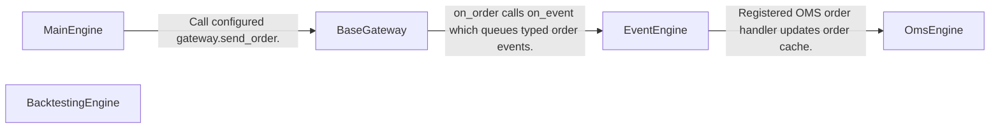
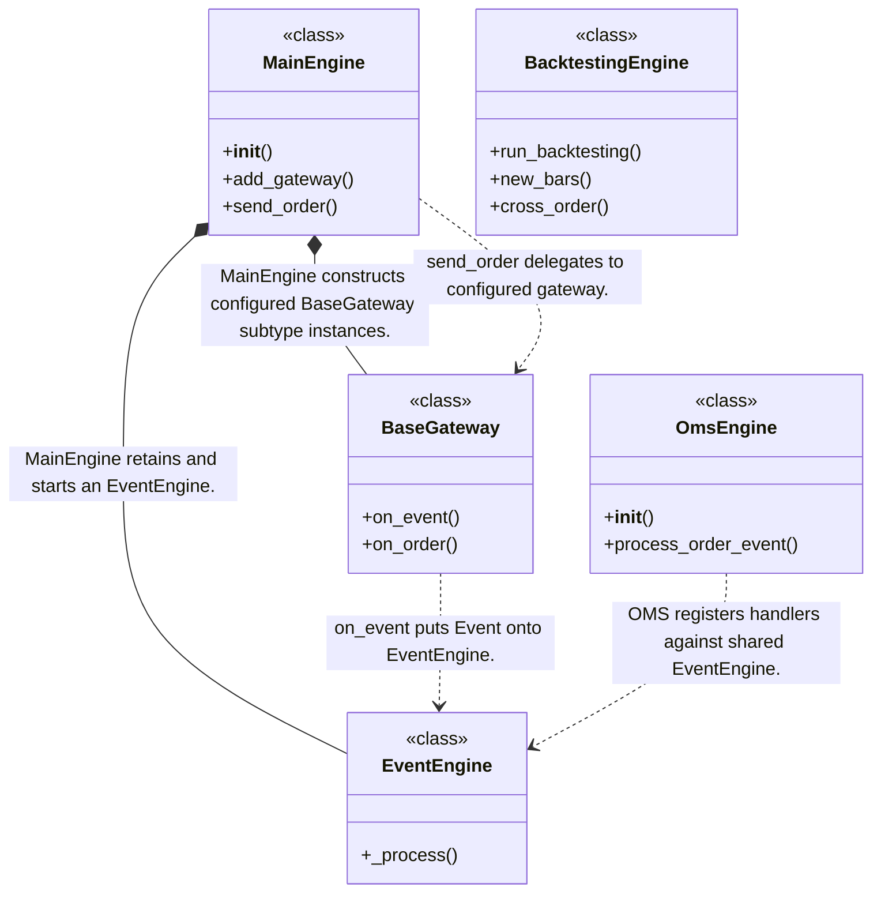
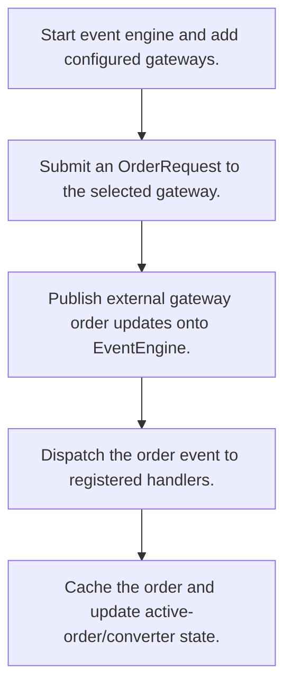
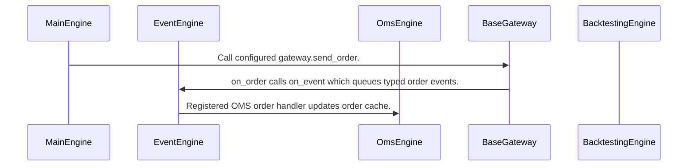

# VeighNa: workflow, design and architecture

Updated: **2026-10-13**
Reviewed Git hash: `fbe7d7940e45206491063d56b6c4a6d581d35d0a`
Branch: `feature/ayu_develop`
Source diff SHA256: `e3b0c44298fc1c149afbf4c8996fb92427ae41e4649b934ca495991b7852b855`
Scope: **Event-driven trading platform core and alpha backtester** / Maintenance: **active**
Languages: Python

[HTML edition](ayu-develop.html) / [Development](development.md) / [Historical validation](validation.md) / [Full system comparison](../../docs/index.html)

## Purpose and scope

Route typed trading events and gateway commands through core engines, and run the bundled equity alpha historical simulator.

## Features and support boundaries

Native = implemented here. Integration = supplied through a named host/API. Limited = material restriction. Not provided = evidenced scope exclusion. Unverified = support/absence not established. Not applicable = outside this artifact type.

| Capability | Status | Implementation and limits | Source |
|---|---|---|---|
| Backtesting | Native | Bundled alpha strategy BacktestingEngine replays history and matches orders. | [BacktestingEngine.run_backtesting](../src/vnpy/alpha/strategy/backtesting.py) ([L171](https://github.com/alexcwyu/vnpy/blob/fbe7d7940e45206491063d56b6c4a6d581d35d0a/src/vnpy/alpha/strategy/backtesting.py#L171)) / [BacktestingEngine.new_bars](../src/vnpy/alpha/strategy/backtesting.py) ([L607](https://github.com/alexcwyu/vnpy/blob/fbe7d7940e45206491063d56b6c4a6d581d35d0a/src/vnpy/alpha/strategy/backtesting.py#L607)) / [BacktestingEngine.cross_order](../src/vnpy/alpha/strategy/backtesting.py) ([L648](https://github.com/alexcwyu/vnpy/blob/fbe7d7940e45206491063d56b6c4a6d581d35d0a/src/vnpy/alpha/strategy/backtesting.py#L648)) |
| Live execution | Integration | MainEngine delegates send_order to configured gateway implementation. Concrete external gateway service operation is outside the reviewed core. | [MainEngine.__init__](../src/vnpy/trader/engine.py) ([L94](https://github.com/alexcwyu/vnpy/blob/fbe7d7940e45206491063d56b6c4a6d581d35d0a/src/vnpy/trader/engine.py#L94)) / [MainEngine.add_gateway](../src/vnpy/trader/engine.py) ([L120](https://github.com/alexcwyu/vnpy/blob/fbe7d7940e45206491063d56b6c4a6d581d35d0a/src/vnpy/trader/engine.py#L120)) / [MainEngine.send_order](../src/vnpy/trader/engine.py) ([L265](https://github.com/alexcwyu/vnpy/blob/fbe7d7940e45206491063d56b6c4a6d581d35d0a/src/vnpy/trader/engine.py#L265)) / [BaseGateway.on_event](../src/vnpy/trader/gateway.py) ([L92](https://github.com/alexcwyu/vnpy/blob/fbe7d7940e45206491063d56b6c4a6d581d35d0a/src/vnpy/trader/gateway.py#L92)) / [BaseGateway.on_order](../src/vnpy/trader/gateway.py) ([L115](https://github.com/alexcwyu/vnpy/blob/fbe7d7940e45206491063d56b6c4a6d581d35d0a/src/vnpy/trader/gateway.py#L115)) |
| Paper trading | Unverified | The inspected source does not establish this capability. This is not a claim of absence. | Not applicable to this repository scope. |
| Event driven | Native | Gateway emits typed events and EventEngine invokes registered handlers. | [EventEngine._process](../src/vnpy/event/engine.py) ([L68](https://github.com/alexcwyu/vnpy/blob/fbe7d7940e45206491063d56b6c4a6d581d35d0a/src/vnpy/event/engine.py#L68)) / [BaseGateway.on_event](../src/vnpy/trader/gateway.py) ([L92](https://github.com/alexcwyu/vnpy/blob/fbe7d7940e45206491063d56b6c4a6d581d35d0a/src/vnpy/trader/gateway.py#L92)) / [BaseGateway.on_order](../src/vnpy/trader/gateway.py) ([L115](https://github.com/alexcwyu/vnpy/blob/fbe7d7940e45206491063d56b6c4a6d581d35d0a/src/vnpy/trader/gateway.py#L115)) |
| Vectorized | Unverified | The inspected source does not establish this capability. This is not a claim of absence. | Not applicable to this repository scope. |
| Order management | Native | OmsEngine maintains current orders and active order set, with per-gateway converters. | [OmsEngine.__init__](../src/vnpy/trader/engine.py) ([L380](https://github.com/alexcwyu/vnpy/blob/fbe7d7940e45206491063d56b6c4a6d581d35d0a/src/vnpy/trader/engine.py#L380)) / [OmsEngine.process_order_event](../src/vnpy/trader/engine.py) ([L420](https://github.com/alexcwyu/vnpy/blob/fbe7d7940e45206491063d56b6c4a6d581d35d0a/src/vnpy/trader/engine.py#L420)) |
| Order types | Limited | Bundled alpha simulator matches limit orders. Live venue order types are defined by external gateways. | [MainEngine.__init__](../src/vnpy/trader/engine.py) ([L94](https://github.com/alexcwyu/vnpy/blob/fbe7d7940e45206491063d56b6c4a6d581d35d0a/src/vnpy/trader/engine.py#L94)) / [MainEngine.add_gateway](../src/vnpy/trader/engine.py) ([L120](https://github.com/alexcwyu/vnpy/blob/fbe7d7940e45206491063d56b6c4a6d581d35d0a/src/vnpy/trader/engine.py#L120)) / [MainEngine.send_order](../src/vnpy/trader/engine.py) ([L265](https://github.com/alexcwyu/vnpy/blob/fbe7d7940e45206491063d56b6c4a6d581d35d0a/src/vnpy/trader/engine.py#L265)) / [BacktestingEngine.run_backtesting](../src/vnpy/alpha/strategy/backtesting.py) ([L171](https://github.com/alexcwyu/vnpy/blob/fbe7d7940e45206491063d56b6c4a6d581d35d0a/src/vnpy/alpha/strategy/backtesting.py#L171)) / [BacktestingEngine.new_bars](../src/vnpy/alpha/strategy/backtesting.py) ([L607](https://github.com/alexcwyu/vnpy/blob/fbe7d7940e45206491063d56b6c4a6d581d35d0a/src/vnpy/alpha/strategy/backtesting.py#L607)) / [BacktestingEngine.cross_order](../src/vnpy/alpha/strategy/backtesting.py) ([L648](https://github.com/alexcwyu/vnpy/blob/fbe7d7940e45206491063d56b6c4a6d581d35d0a/src/vnpy/alpha/strategy/backtesting.py#L648)) |
| Multi venue | Integration | MainEngine stores named gateway instances and routes orders by gateway name. | [MainEngine.__init__](../src/vnpy/trader/engine.py) ([L94](https://github.com/alexcwyu/vnpy/blob/fbe7d7940e45206491063d56b6c4a6d581d35d0a/src/vnpy/trader/engine.py#L94)) / [MainEngine.add_gateway](../src/vnpy/trader/engine.py) ([L120](https://github.com/alexcwyu/vnpy/blob/fbe7d7940e45206491063d56b6c4a6d581d35d0a/src/vnpy/trader/engine.py#L120)) / [MainEngine.send_order](../src/vnpy/trader/engine.py) ([L265](https://github.com/alexcwyu/vnpy/blob/fbe7d7940e45206491063d56b6c4a6d581d35d0a/src/vnpy/trader/engine.py#L265)) |
| Crypto | Unverified | The inspected source does not establish this capability. This is not a claim of absence. | Not applicable to this repository scope. |
| Equities | Native | Bundled alpha order matching includes daily equity price-limit conditions. | [BacktestingEngine.run_backtesting](../src/vnpy/alpha/strategy/backtesting.py) ([L171](https://github.com/alexcwyu/vnpy/blob/fbe7d7940e45206491063d56b6c4a6d581d35d0a/src/vnpy/alpha/strategy/backtesting.py#L171)) / [BacktestingEngine.new_bars](../src/vnpy/alpha/strategy/backtesting.py) ([L607](https://github.com/alexcwyu/vnpy/blob/fbe7d7940e45206491063d56b6c4a6d581d35d0a/src/vnpy/alpha/strategy/backtesting.py#L607)) / [BacktestingEngine.cross_order](../src/vnpy/alpha/strategy/backtesting.py) ([L648](https://github.com/alexcwyu/vnpy/blob/fbe7d7940e45206491063d56b6c4a6d581d35d0a/src/vnpy/alpha/strategy/backtesting.py#L648)) |
| Futures | Unverified | The inspected source does not establish this capability. This is not a claim of absence. | Not applicable to this repository scope. |
| Options | Unverified | The inspected source does not establish this capability. This is not a claim of absence. | Not applicable to this repository scope. |
| Forex | Unverified | The inspected source does not establish this capability. This is not a claim of absence. | Not applicable to this repository scope. |
| Strategy api | Native | Alpha strategies receive on_init and on_bars callbacks. | [BacktestingEngine.run_backtesting](../src/vnpy/alpha/strategy/backtesting.py) ([L171](https://github.com/alexcwyu/vnpy/blob/fbe7d7940e45206491063d56b6c4a6d581d35d0a/src/vnpy/alpha/strategy/backtesting.py#L171)) / [BacktestingEngine.new_bars](../src/vnpy/alpha/strategy/backtesting.py) ([L607](https://github.com/alexcwyu/vnpy/blob/fbe7d7940e45206491063d56b6c4a6d581d35d0a/src/vnpy/alpha/strategy/backtesting.py#L607)) / [BacktestingEngine.cross_order](../src/vnpy/alpha/strategy/backtesting.py) ([L648](https://github.com/alexcwyu/vnpy/blob/fbe7d7940e45206491063d56b6c4a6d581d35d0a/src/vnpy/alpha/strategy/backtesting.py#L648)) |
| Optimization | Unverified | The inspected source does not establish this capability. This is not a claim of absence. | Not applicable to this repository scope. |
| Machine learning | Unverified | The inspected source does not establish this capability. This is not a claim of absence. | Not applicable to this repository scope. |
| Reinforcement learning | Unverified | The inspected source does not establish this capability. This is not a claim of absence. | Not applicable to this repository scope. |
| Portfolio | Native | Alpha simulator processes multiple vt_symbols and updates daily portfolio result inputs. | [BacktestingEngine.run_backtesting](../src/vnpy/alpha/strategy/backtesting.py) ([L171](https://github.com/alexcwyu/vnpy/blob/fbe7d7940e45206491063d56b6c4a6d581d35d0a/src/vnpy/alpha/strategy/backtesting.py#L171)) / [BacktestingEngine.new_bars](../src/vnpy/alpha/strategy/backtesting.py) ([L607](https://github.com/alexcwyu/vnpy/blob/fbe7d7940e45206491063d56b6c4a6d581d35d0a/src/vnpy/alpha/strategy/backtesting.py#L607)) / [BacktestingEngine.cross_order](../src/vnpy/alpha/strategy/backtesting.py) ([L648](https://github.com/alexcwyu/vnpy/blob/fbe7d7940e45206491063d56b6c4a6d581d35d0a/src/vnpy/alpha/strategy/backtesting.py#L648)) |
| Risk management | Unverified | The inspected source does not establish this capability. This is not a claim of absence. | Not applicable to this repository scope. |
| Performance analytics | Native | Alpha replay maintains daily closes and historical fills used by result/statistics APIs. | [BacktestingEngine.run_backtesting](../src/vnpy/alpha/strategy/backtesting.py) ([L171](https://github.com/alexcwyu/vnpy/blob/fbe7d7940e45206491063d56b6c4a6d581d35d0a/src/vnpy/alpha/strategy/backtesting.py#L171)) / [BacktestingEngine.new_bars](../src/vnpy/alpha/strategy/backtesting.py) ([L607](https://github.com/alexcwyu/vnpy/blob/fbe7d7940e45206491063d56b6c4a6d581d35d0a/src/vnpy/alpha/strategy/backtesting.py#L607)) / [BacktestingEngine.cross_order](../src/vnpy/alpha/strategy/backtesting.py) ([L648](https://github.com/alexcwyu/vnpy/blob/fbe7d7940e45206491063d56b6c4a6d581d35d0a/src/vnpy/alpha/strategy/backtesting.py#L648)) |
| Historical data | Native | Alpha simulator reads history_data keyed by timestamp and symbol. | [BacktestingEngine.run_backtesting](../src/vnpy/alpha/strategy/backtesting.py) ([L171](https://github.com/alexcwyu/vnpy/blob/fbe7d7940e45206491063d56b6c4a6d581d35d0a/src/vnpy/alpha/strategy/backtesting.py#L171)) / [BacktestingEngine.new_bars](../src/vnpy/alpha/strategy/backtesting.py) ([L607](https://github.com/alexcwyu/vnpy/blob/fbe7d7940e45206491063d56b6c4a6d581d35d0a/src/vnpy/alpha/strategy/backtesting.py#L607)) / [BacktestingEngine.cross_order](../src/vnpy/alpha/strategy/backtesting.py) ([L648](https://github.com/alexcwyu/vnpy/blob/fbe7d7940e45206491063d56b6c4a6d581d35d0a/src/vnpy/alpha/strategy/backtesting.py#L648)) |
| Streaming data | Integration | Gateway events carry externally supplied market/order updates to the host. | [EventEngine._process](../src/vnpy/event/engine.py) ([L68](https://github.com/alexcwyu/vnpy/blob/fbe7d7940e45206491063d56b6c4a6d581d35d0a/src/vnpy/event/engine.py#L68)) / [BaseGateway.on_event](../src/vnpy/trader/gateway.py) ([L92](https://github.com/alexcwyu/vnpy/blob/fbe7d7940e45206491063d56b6c4a6d581d35d0a/src/vnpy/trader/gateway.py#L92)) / [BaseGateway.on_order](../src/vnpy/trader/gateway.py) ([L115](https://github.com/alexcwyu/vnpy/blob/fbe7d7940e45206491063d56b6c4a6d581d35d0a/src/vnpy/trader/gateway.py#L115)) |
| Persistence | Unverified | The inspected source does not establish this capability. This is not a claim of absence. | Not applicable to this repository scope. |
| Data pipeline | Unverified | The inspected source does not establish this capability. This is not a claim of absence. | Not applicable to this repository scope. |
| Web ui | Unverified | The examined core does not establish a web UI. Upstream desktop and external apps must be distinguished. | Not applicable to this repository scope. |
| Cli | Unverified | The inspected source does not establish this capability. This is not a claim of absence. | Not applicable to this repository scope. |
| Monitoring | Native | OMS retains tick/order/position/account state and MainEngine logs order submission. | [MainEngine.__init__](../src/vnpy/trader/engine.py) ([L94](https://github.com/alexcwyu/vnpy/blob/fbe7d7940e45206491063d56b6c4a6d581d35d0a/src/vnpy/trader/engine.py#L94)) / [MainEngine.add_gateway](../src/vnpy/trader/engine.py) ([L120](https://github.com/alexcwyu/vnpy/blob/fbe7d7940e45206491063d56b6c4a6d581d35d0a/src/vnpy/trader/engine.py#L120)) / [MainEngine.send_order](../src/vnpy/trader/engine.py) ([L265](https://github.com/alexcwyu/vnpy/blob/fbe7d7940e45206491063d56b6c4a6d581d35d0a/src/vnpy/trader/engine.py#L265)) / [OmsEngine.__init__](../src/vnpy/trader/engine.py) ([L380](https://github.com/alexcwyu/vnpy/blob/fbe7d7940e45206491063d56b6c4a6d581d35d0a/src/vnpy/trader/engine.py#L380)) / [OmsEngine.process_order_event](../src/vnpy/trader/engine.py) ([L420](https://github.com/alexcwyu/vnpy/blob/fbe7d7940e45206491063d56b6c4a6d581d35d0a/src/vnpy/trader/engine.py#L420)) |
| Extension api | Native | MainEngine registers gateway and application engines with a shared event bus. | [MainEngine.__init__](../src/vnpy/trader/engine.py) ([L94](https://github.com/alexcwyu/vnpy/blob/fbe7d7940e45206491063d56b6c4a6d581d35d0a/src/vnpy/trader/engine.py#L94)) / [MainEngine.add_gateway](../src/vnpy/trader/engine.py) ([L120](https://github.com/alexcwyu/vnpy/blob/fbe7d7940e45206491063d56b6c4a6d581d35d0a/src/vnpy/trader/engine.py#L120)) / [MainEngine.send_order](../src/vnpy/trader/engine.py) ([L265](https://github.com/alexcwyu/vnpy/blob/fbe7d7940e45206491063d56b6c4a6d581d35d0a/src/vnpy/trader/engine.py#L265)) |
| Native acceleration | Unverified | The inspected source does not establish this capability. This is not a claim of absence. | Not applicable to this repository scope. |
| Distributed execution | Unverified | The inspected source does not establish this capability. This is not a claim of absence. | Not applicable to this repository scope. |

## System components

| Component | Responsibility | Source |
|---|---|---|
| MainEngine | Trading host and gateway/app routing. | [MainEngine.__init__](../src/vnpy/trader/engine.py) ([L94](https://github.com/alexcwyu/vnpy/blob/fbe7d7940e45206491063d56b6c4a6d581d35d0a/src/vnpy/trader/engine.py#L94)) / [MainEngine.add_gateway](../src/vnpy/trader/engine.py) ([L120](https://github.com/alexcwyu/vnpy/blob/fbe7d7940e45206491063d56b6c4a6d581d35d0a/src/vnpy/trader/engine.py#L120)) / [MainEngine.send_order](../src/vnpy/trader/engine.py) ([L265](https://github.com/alexcwyu/vnpy/blob/fbe7d7940e45206491063d56b6c4a6d581d35d0a/src/vnpy/trader/engine.py#L265)) |
| EventEngine | Threaded event bus dispatch. | [EventEngine._process](../src/vnpy/event/engine.py) ([L68](https://github.com/alexcwyu/vnpy/blob/fbe7d7940e45206491063d56b6c4a6d581d35d0a/src/vnpy/event/engine.py#L68)) |
| OmsEngine | Host order and market-state cache. | [OmsEngine.__init__](../src/vnpy/trader/engine.py) ([L380](https://github.com/alexcwyu/vnpy/blob/fbe7d7940e45206491063d56b6c4a6d581d35d0a/src/vnpy/trader/engine.py#L380)) / [OmsEngine.process_order_event](../src/vnpy/trader/engine.py) ([L420](https://github.com/alexcwyu/vnpy/blob/fbe7d7940e45206491063d56b6c4a6d581d35d0a/src/vnpy/trader/engine.py#L420)) |
| BaseGateway | External gateway event contract. | [BaseGateway.on_event](../src/vnpy/trader/gateway.py) ([L92](https://github.com/alexcwyu/vnpy/blob/fbe7d7940e45206491063d56b6c4a6d581d35d0a/src/vnpy/trader/gateway.py#L92)) / [BaseGateway.on_order](../src/vnpy/trader/gateway.py) ([L115](https://github.com/alexcwyu/vnpy/blob/fbe7d7940e45206491063d56b6c4a6d581d35d0a/src/vnpy/trader/gateway.py#L115)) |
| BacktestingEngine | Bundled alpha historical portfolio simulator. | [BacktestingEngine.run_backtesting](../src/vnpy/alpha/strategy/backtesting.py) ([L171](https://github.com/alexcwyu/vnpy/blob/fbe7d7940e45206491063d56b6c4a6d581d35d0a/src/vnpy/alpha/strategy/backtesting.py#L171)) / [BacktestingEngine.new_bars](../src/vnpy/alpha/strategy/backtesting.py) ([L607](https://github.com/alexcwyu/vnpy/blob/fbe7d7940e45206491063d56b6c4a6d581d35d0a/src/vnpy/alpha/strategy/backtesting.py#L607)) / [BacktestingEngine.cross_order](../src/vnpy/alpha/strategy/backtesting.py) ([L648](https://github.com/alexcwyu/vnpy/blob/fbe7d7940e45206491063d56b6c4a6d581d35d0a/src/vnpy/alpha/strategy/backtesting.py#L648)) |

## Architecture and component boundaries

The component view summarizes inspected responsibility boundaries. Arrows identify the documented API/data dependencies; this is not a deployment-readiness claim.

- Call configured gateway.send_order.: [MainEngine.__init__](../src/vnpy/trader/engine.py) ([L94](https://github.com/alexcwyu/vnpy/blob/fbe7d7940e45206491063d56b6c4a6d581d35d0a/src/vnpy/trader/engine.py#L94)) / [MainEngine.add_gateway](../src/vnpy/trader/engine.py) ([L120](https://github.com/alexcwyu/vnpy/blob/fbe7d7940e45206491063d56b6c4a6d581d35d0a/src/vnpy/trader/engine.py#L120)) / [MainEngine.send_order](../src/vnpy/trader/engine.py) ([L265](https://github.com/alexcwyu/vnpy/blob/fbe7d7940e45206491063d56b6c4a6d581d35d0a/src/vnpy/trader/engine.py#L265))
- on_order calls on_event which queues typed order events.: [BaseGateway.on_event](../src/vnpy/trader/gateway.py) ([L92](https://github.com/alexcwyu/vnpy/blob/fbe7d7940e45206491063d56b6c4a6d581d35d0a/src/vnpy/trader/gateway.py#L92)) / [BaseGateway.on_order](../src/vnpy/trader/gateway.py) ([L115](https://github.com/alexcwyu/vnpy/blob/fbe7d7940e45206491063d56b6c4a6d581d35d0a/src/vnpy/trader/gateway.py#L115))
- Registered OMS order handler updates order cache.: [EventEngine._process](../src/vnpy/event/engine.py) ([L68](https://github.com/alexcwyu/vnpy/blob/fbe7d7940e45206491063d56b6c4a6d581d35d0a/src/vnpy/event/engine.py#L68)) / [OmsEngine.__init__](../src/vnpy/trader/engine.py) ([L380](https://github.com/alexcwyu/vnpy/blob/fbe7d7940e45206491063d56b6c4a6d581d35d0a/src/vnpy/trader/engine.py#L380)) / [OmsEngine.process_order_event](../src/vnpy/trader/engine.py) ([L420](https://github.com/alexcwyu/vnpy/blob/fbe7d7940e45206491063d56b6c4a6d581d35d0a/src/vnpy/trader/engine.py#L420))

## Design decisions

| Decision | Rationale | Tradeoff | Evidence |
|---|---|---|---|
| Keep host command routing separate from gateway connectivity. | External gateway plugins implement venue protocols while the host shares event and OMS infrastructure. | Source-backed gateway routing does not validate any particular venue service. | [MainEngine.__init__](../src/vnpy/trader/engine.py) ([L94](https://github.com/alexcwyu/vnpy/blob/fbe7d7940e45206491063d56b6c4a6d581d35d0a/src/vnpy/trader/engine.py#L94)) / [MainEngine.add_gateway](../src/vnpy/trader/engine.py) ([L120](https://github.com/alexcwyu/vnpy/blob/fbe7d7940e45206491063d56b6c4a6d581d35d0a/src/vnpy/trader/engine.py#L120)) / [MainEngine.send_order](../src/vnpy/trader/engine.py) ([L265](https://github.com/alexcwyu/vnpy/blob/fbe7d7940e45206491063d56b6c4a6d581d35d0a/src/vnpy/trader/engine.py#L265)) / [BaseGateway.on_event](../src/vnpy/trader/gateway.py) ([L92](https://github.com/alexcwyu/vnpy/blob/fbe7d7940e45206491063d56b6c4a6d581d35d0a/src/vnpy/trader/gateway.py#L92)) / [BaseGateway.on_order](../src/vnpy/trader/gateway.py) ([L115](https://github.com/alexcwyu/vnpy/blob/fbe7d7940e45206491063d56b6c4a6d581d35d0a/src/vnpy/trader/gateway.py#L115)) |
| Match historical alpha orders before the strategy on_bars callback. | Previously queued limit orders are evaluated on the current bar before new decisions. | Equity OHLC matching and price-limit assumptions constrain fill realism. | [BacktestingEngine.run_backtesting](../src/vnpy/alpha/strategy/backtesting.py) ([L171](https://github.com/alexcwyu/vnpy/blob/fbe7d7940e45206491063d56b6c4a6d581d35d0a/src/vnpy/alpha/strategy/backtesting.py#L171)) / [BacktestingEngine.new_bars](../src/vnpy/alpha/strategy/backtesting.py) ([L607](https://github.com/alexcwyu/vnpy/blob/fbe7d7940e45206491063d56b6c4a6d581d35d0a/src/vnpy/alpha/strategy/backtesting.py#L607)) / [BacktestingEngine.cross_order](../src/vnpy/alpha/strategy/backtesting.py) ([L648](https://github.com/alexcwyu/vnpy/blob/fbe7d7940e45206491063d56b6c4a6d581d35d0a/src/vnpy/alpha/strategy/backtesting.py#L648)) |

## Class and interface relationships

Each node is a reviewed source symbol. Function/module nodes are explicitly labeled; they do not imply Python classes. Only reviewed relationships are drawn.

- **MainEngine** (class): [MainEngine.__init__](../src/vnpy/trader/engine.py) ([L94](https://github.com/alexcwyu/vnpy/blob/fbe7d7940e45206491063d56b6c4a6d581d35d0a/src/vnpy/trader/engine.py#L94)) / [MainEngine.add_gateway](../src/vnpy/trader/engine.py) ([L120](https://github.com/alexcwyu/vnpy/blob/fbe7d7940e45206491063d56b6c4a6d581d35d0a/src/vnpy/trader/engine.py#L120)) / [MainEngine.send_order](../src/vnpy/trader/engine.py) ([L265](https://github.com/alexcwyu/vnpy/blob/fbe7d7940e45206491063d56b6c4a6d581d35d0a/src/vnpy/trader/engine.py#L265))
- **EventEngine** (class): [EventEngine._process](../src/vnpy/event/engine.py) ([L68](https://github.com/alexcwyu/vnpy/blob/fbe7d7940e45206491063d56b6c4a6d581d35d0a/src/vnpy/event/engine.py#L68))
- **OmsEngine** (class): [OmsEngine.__init__](../src/vnpy/trader/engine.py) ([L380](https://github.com/alexcwyu/vnpy/blob/fbe7d7940e45206491063d56b6c4a6d581d35d0a/src/vnpy/trader/engine.py#L380)) / [OmsEngine.process_order_event](../src/vnpy/trader/engine.py) ([L420](https://github.com/alexcwyu/vnpy/blob/fbe7d7940e45206491063d56b6c4a6d581d35d0a/src/vnpy/trader/engine.py#L420))
- **BaseGateway** (class): [BaseGateway.on_event](../src/vnpy/trader/gateway.py) ([L92](https://github.com/alexcwyu/vnpy/blob/fbe7d7940e45206491063d56b6c4a6d581d35d0a/src/vnpy/trader/gateway.py#L92)) / [BaseGateway.on_order](../src/vnpy/trader/gateway.py) ([L115](https://github.com/alexcwyu/vnpy/blob/fbe7d7940e45206491063d56b6c4a6d581d35d0a/src/vnpy/trader/gateway.py#L115))
- **BacktestingEngine** (class): [BacktestingEngine.run_backtesting](../src/vnpy/alpha/strategy/backtesting.py) ([L171](https://github.com/alexcwyu/vnpy/blob/fbe7d7940e45206491063d56b6c4a6d581d35d0a/src/vnpy/alpha/strategy/backtesting.py#L171)) / [BacktestingEngine.new_bars](../src/vnpy/alpha/strategy/backtesting.py) ([L607](https://github.com/alexcwyu/vnpy/blob/fbe7d7940e45206491063d56b6c4a6d581d35d0a/src/vnpy/alpha/strategy/backtesting.py#L607)) / [BacktestingEngine.cross_order](../src/vnpy/alpha/strategy/backtesting.py) ([L648](https://github.com/alexcwyu/vnpy/blob/fbe7d7940e45206491063d56b6c4a6d581d35d0a/src/vnpy/alpha/strategy/backtesting.py#L648))

## Workflow

### Representative source-backed flow

The steps describe the inspected implementation. User configuration and data inputs are external prerequisites.

1. Start event engine and add configured gateways.. [MainEngine.__init__](../src/vnpy/trader/engine.py) ([L94](https://github.com/alexcwyu/vnpy/blob/fbe7d7940e45206491063d56b6c4a6d581d35d0a/src/vnpy/trader/engine.py#L94)) / [MainEngine.add_gateway](../src/vnpy/trader/engine.py) ([L120](https://github.com/alexcwyu/vnpy/blob/fbe7d7940e45206491063d56b6c4a6d581d35d0a/src/vnpy/trader/engine.py#L120)) / [MainEngine.send_order](../src/vnpy/trader/engine.py) ([L265](https://github.com/alexcwyu/vnpy/blob/fbe7d7940e45206491063d56b6c4a6d581d35d0a/src/vnpy/trader/engine.py#L265))
2. Submit an OrderRequest to the selected gateway.. [MainEngine.__init__](../src/vnpy/trader/engine.py) ([L94](https://github.com/alexcwyu/vnpy/blob/fbe7d7940e45206491063d56b6c4a6d581d35d0a/src/vnpy/trader/engine.py#L94)) / [MainEngine.add_gateway](../src/vnpy/trader/engine.py) ([L120](https://github.com/alexcwyu/vnpy/blob/fbe7d7940e45206491063d56b6c4a6d581d35d0a/src/vnpy/trader/engine.py#L120)) / [MainEngine.send_order](../src/vnpy/trader/engine.py) ([L265](https://github.com/alexcwyu/vnpy/blob/fbe7d7940e45206491063d56b6c4a6d581d35d0a/src/vnpy/trader/engine.py#L265))
3. Publish external gateway order updates onto EventEngine.. [BaseGateway.on_event](../src/vnpy/trader/gateway.py) ([L92](https://github.com/alexcwyu/vnpy/blob/fbe7d7940e45206491063d56b6c4a6d581d35d0a/src/vnpy/trader/gateway.py#L92)) / [BaseGateway.on_order](../src/vnpy/trader/gateway.py) ([L115](https://github.com/alexcwyu/vnpy/blob/fbe7d7940e45206491063d56b6c4a6d581d35d0a/src/vnpy/trader/gateway.py#L115))
4. Dispatch the order event to registered handlers.. [EventEngine._process](../src/vnpy/event/engine.py) ([L68](https://github.com/alexcwyu/vnpy/blob/fbe7d7940e45206491063d56b6c4a6d581d35d0a/src/vnpy/event/engine.py#L68))
5. Cache the order and update active-order/converter state.. [OmsEngine.__init__](../src/vnpy/trader/engine.py) ([L380](https://github.com/alexcwyu/vnpy/blob/fbe7d7940e45206491063d56b6c4a6d581d35d0a/src/vnpy/trader/engine.py#L380)) / [OmsEngine.process_order_event](../src/vnpy/trader/engine.py) ([L420](https://github.com/alexcwyu/vnpy/blob/fbe7d7940e45206491063d56b6c4a6d581d35d0a/src/vnpy/trader/engine.py#L420))

## Sequence

Representative calls and data dependencies

Messages represent inspected calls or explicitly labelled data dependencies. A data dependency is not an asserted direct runtime call.

- Call configured gateway.send_order.: [MainEngine.__init__](../src/vnpy/trader/engine.py) ([L94](https://github.com/alexcwyu/vnpy/blob/fbe7d7940e45206491063d56b6c4a6d581d35d0a/src/vnpy/trader/engine.py#L94)) / [MainEngine.add_gateway](../src/vnpy/trader/engine.py) ([L120](https://github.com/alexcwyu/vnpy/blob/fbe7d7940e45206491063d56b6c4a6d581d35d0a/src/vnpy/trader/engine.py#L120)) / [MainEngine.send_order](../src/vnpy/trader/engine.py) ([L265](https://github.com/alexcwyu/vnpy/blob/fbe7d7940e45206491063d56b6c4a6d581d35d0a/src/vnpy/trader/engine.py#L265))
- on_order calls on_event which queues typed order events.: [BaseGateway.on_event](../src/vnpy/trader/gateway.py) ([L92](https://github.com/alexcwyu/vnpy/blob/fbe7d7940e45206491063d56b6c4a6d581d35d0a/src/vnpy/trader/gateway.py#L92)) / [BaseGateway.on_order](../src/vnpy/trader/gateway.py) ([L115](https://github.com/alexcwyu/vnpy/blob/fbe7d7940e45206491063d56b6c4a6d581d35d0a/src/vnpy/trader/gateway.py#L115))
- Registered OMS order handler updates order cache.: [EventEngine._process](../src/vnpy/event/engine.py) ([L68](https://github.com/alexcwyu/vnpy/blob/fbe7d7940e45206491063d56b6c4a6d581d35d0a/src/vnpy/event/engine.py#L68)) / [OmsEngine.__init__](../src/vnpy/trader/engine.py) ([L380](https://github.com/alexcwyu/vnpy/blob/fbe7d7940e45206491063d56b6c4a6d581d35d0a/src/vnpy/trader/engine.py#L380)) / [OmsEngine.process_order_event](../src/vnpy/trader/engine.py) ([L420](https://github.com/alexcwyu/vnpy/blob/fbe7d7940e45206491063d56b6c4a6d581d35d0a/src/vnpy/trader/engine.py#L420))

## Strengths and limits

### Strengths

- Host events, order cache and gateway routing have clear implementation boundaries. [MainEngine.__init__](../src/vnpy/trader/engine.py) ([L94](https://github.com/alexcwyu/vnpy/blob/fbe7d7940e45206491063d56b6c4a6d581d35d0a/src/vnpy/trader/engine.py#L94)) / [MainEngine.add_gateway](../src/vnpy/trader/engine.py) ([L120](https://github.com/alexcwyu/vnpy/blob/fbe7d7940e45206491063d56b6c4a6d581d35d0a/src/vnpy/trader/engine.py#L120)) / [MainEngine.send_order](../src/vnpy/trader/engine.py) ([L265](https://github.com/alexcwyu/vnpy/blob/fbe7d7940e45206491063d56b6c4a6d581d35d0a/src/vnpy/trader/engine.py#L265)) / [EventEngine._process](../src/vnpy/event/engine.py) ([L68](https://github.com/alexcwyu/vnpy/blob/fbe7d7940e45206491063d56b6c4a6d581d35d0a/src/vnpy/event/engine.py#L68)) / [OmsEngine.__init__](../src/vnpy/trader/engine.py) ([L380](https://github.com/alexcwyu/vnpy/blob/fbe7d7940e45206491063d56b6c4a6d581d35d0a/src/vnpy/trader/engine.py#L380)) / [OmsEngine.process_order_event](../src/vnpy/trader/engine.py) ([L420](https://github.com/alexcwyu/vnpy/blob/fbe7d7940e45206491063d56b6c4a6d581d35d0a/src/vnpy/trader/engine.py#L420)) / [BaseGateway.on_event](../src/vnpy/trader/gateway.py) ([L92](https://github.com/alexcwyu/vnpy/blob/fbe7d7940e45206491063d56b6c4a6d581d35d0a/src/vnpy/trader/gateway.py#L92)) / [BaseGateway.on_order](../src/vnpy/trader/gateway.py) ([L115](https://github.com/alexcwyu/vnpy/blob/fbe7d7940e45206491063d56b6c4a6d581d35d0a/src/vnpy/trader/gateway.py#L115))
- The current repository includes a native alpha backtester, separate from external CTA applications. [BacktestingEngine.run_backtesting](../src/vnpy/alpha/strategy/backtesting.py) ([L171](https://github.com/alexcwyu/vnpy/blob/fbe7d7940e45206491063d56b6c4a6d581d35d0a/src/vnpy/alpha/strategy/backtesting.py#L171)) / [BacktestingEngine.new_bars](../src/vnpy/alpha/strategy/backtesting.py) ([L607](https://github.com/alexcwyu/vnpy/blob/fbe7d7940e45206491063d56b6c4a6d581d35d0a/src/vnpy/alpha/strategy/backtesting.py#L607)) / [BacktestingEngine.cross_order](../src/vnpy/alpha/strategy/backtesting.py) ([L648](https://github.com/alexcwyu/vnpy/blob/fbe7d7940e45206491063d56b6c4a6d581d35d0a/src/vnpy/alpha/strategy/backtesting.py#L648))

### Limitations

- External CTA, spread, options and gateway plugins must not be described as bundled core implementation without inspecting their packages. [MainEngine.__init__](../src/vnpy/trader/engine.py) ([L94](https://github.com/alexcwyu/vnpy/blob/fbe7d7940e45206491063d56b6c4a6d581d35d0a/src/vnpy/trader/engine.py#L94)) / [MainEngine.add_gateway](../src/vnpy/trader/engine.py) ([L120](https://github.com/alexcwyu/vnpy/blob/fbe7d7940e45206491063d56b6c4a6d581d35d0a/src/vnpy/trader/engine.py#L120)) / [MainEngine.send_order](../src/vnpy/trader/engine.py) ([L265](https://github.com/alexcwyu/vnpy/blob/fbe7d7940e45206491063d56b6c4a6d581d35d0a/src/vnpy/trader/engine.py#L265))

## Validation scope

The linked validation and command records preserve actual historical runs and user-authorized exclusions. This source/document review does not rerun application tests, establish live trading readiness or rank benchmark performance. Current data, credential and runtime prerequisites remain material.

[Repository validation](validation.md) / [Executed checks](maintenance/index.md)

## Source map

| Reviewed symbol/path | Inspected responsibility | Actual file SHA256 |
|---|---|---|
| [MainEngine.__init__](../src/vnpy/trader/engine.py) ([L94](https://github.com/alexcwyu/vnpy/blob/fbe7d7940e45206491063d56b6c4a6d581d35d0a/src/vnpy/trader/engine.py#L94)) | Starts EventEngine and initializes gateway/engine/app registries and built-in engines. | `099fcf893d9c829561df48fa8b5662d40798d3f4e8cc236760169553b874deac` |
| [MainEngine.add_gateway](../src/vnpy/trader/engine.py) ([L120](https://github.com/alexcwyu/vnpy/blob/fbe7d7940e45206491063d56b6c4a6d581d35d0a/src/vnpy/trader/engine.py#L120)) | Constructs gateway using shared EventEngine and records its supported exchanges. | `099fcf893d9c829561df48fa8b5662d40798d3f4e8cc236760169553b874deac` |
| [MainEngine.send_order](../src/vnpy/trader/engine.py) ([L265](https://github.com/alexcwyu/vnpy/blob/fbe7d7940e45206491063d56b6c4a6d581d35d0a/src/vnpy/trader/engine.py#L265)) | Looks up configured gateway by name and delegates order request to gateway.send_order. | `099fcf893d9c829561df48fa8b5662d40798d3f4e8cc236760169553b874deac` |
| [EventEngine._process](../src/vnpy/event/engine.py) ([L68](https://github.com/alexcwyu/vnpy/blob/fbe7d7940e45206491063d56b6c4a6d581d35d0a/src/vnpy/event/engine.py#L68)) | Invokes event-type handlers, then general handlers. | `570058908186cbe80ba3407a5682bfb6748cea3242ce94f63fe8b15a0ea7cdc2` |
| [OmsEngine.__init__](../src/vnpy/trader/engine.py) ([L380](https://github.com/alexcwyu/vnpy/blob/fbe7d7940e45206491063d56b6c4a6d581d35d0a/src/vnpy/trader/engine.py#L380)) | Creates tick/order/trade/position/account/contract caches and registers handlers. | `099fcf893d9c829561df48fa8b5662d40798d3f4e8cc236760169553b874deac` |
| [OmsEngine.process_order_event](../src/vnpy/trader/engine.py) ([L420](https://github.com/alexcwyu/vnpy/blob/fbe7d7940e45206491063d56b6c4a6d581d35d0a/src/vnpy/trader/engine.py#L420)) | Caches order, updates active order set and sends update to the gateway offset converter. | `099fcf893d9c829561df48fa8b5662d40798d3f4e8cc236760169553b874deac` |
| [BaseGateway.on_event](../src/vnpy/trader/gateway.py) ([L92](https://github.com/alexcwyu/vnpy/blob/fbe7d7940e45206491063d56b6c4a6d581d35d0a/src/vnpy/trader/gateway.py#L92)) | Wraps supplied data in an Event and puts it on the shared EventEngine. | `6b2821d7c9d35f51c0266aeed9314217f207cf026a173c7f8c3458244a24d0d0` |
| [BaseGateway.on_order](../src/vnpy/trader/gateway.py) ([L115](https://github.com/alexcwyu/vnpy/blob/fbe7d7940e45206491063d56b6c4a6d581d35d0a/src/vnpy/trader/gateway.py#L115)) | Publishes order updates as general order and order-ID-specific events. | `6b2821d7c9d35f51c0266aeed9314217f207cf026a173c7f8c3458244a24d0d0` |
| [BacktestingEngine.run_backtesting](../src/vnpy/alpha/strategy/backtesting.py) ([L171](https://github.com/alexcwyu/vnpy/blob/fbe7d7940e45206491063d56b6c4a6d581d35d0a/src/vnpy/alpha/strategy/backtesting.py#L171)) | Initializes strategy and replays sorted historical timestamps through new_bars. | `956cb65cacdbcd3d01fb04e5360c047c75f8d9aa71f7a5d8946719b1f8a2ed0f` |
| [BacktestingEngine.new_bars](../src/vnpy/alpha/strategy/backtesting.py) ([L607](https://github.com/alexcwyu/vnpy/blob/fbe7d7940e45206491063d56b6c4a6d581d35d0a/src/vnpy/alpha/strategy/backtesting.py#L607)) | Builds current bar maps, crosses orders, calls strategy.on_bars and updates daily closes. | `956cb65cacdbcd3d01fb04e5360c047c75f8d9aa71f7a5d8946719b1f8a2ed0f` |
| [BacktestingEngine.cross_order](../src/vnpy/alpha/strategy/backtesting.py) ([L648](https://github.com/alexcwyu/vnpy/blob/fbe7d7940e45206491063d56b6c4a6d581d35d0a/src/vnpy/alpha/strategy/backtesting.py#L648)) | Matches active limit orders against high/low with equity price-limit checks, updates order state and produces trades. | `956cb65cacdbcd3d01fb04e5360c047c75f8d9aa71f7a5d8946719b1f8a2ed0f` |

## Documentation provenance

Review date: 2026-10-13. Full committed source HEAD: `fbe7d7940e45206491063d56b6c4a6d581d35d0a`. Template version: 2. 4 source files were independently hashed for this guide.

[Evidence catalog](../../docs/systems-2026-10-13/catalog.json) / [Standard template](../../docs/guidelines/APP_TEMPLATE.md)

- Snapshot provenance: inventory.json full HEAD fbe7d7940e45206491063d56b6c4a6d581d35d0a, branch feature/ayu_develop. Source was inspected in the existing checkout and no repository files were changed.
- Inspected implementation bodies and existing architecture documentation. This is a representative static source audit, not a runtime or live-service validation. Credential exclusions in current validation are policy, not evidence that a live connection succeeds.
- Inspected source files: src/vnpy/trader/engine.py, src/vnpy/event/engine.py, src/vnpy/trader/gateway.py, src/vnpy/alpha/strategy/backtesting.py
